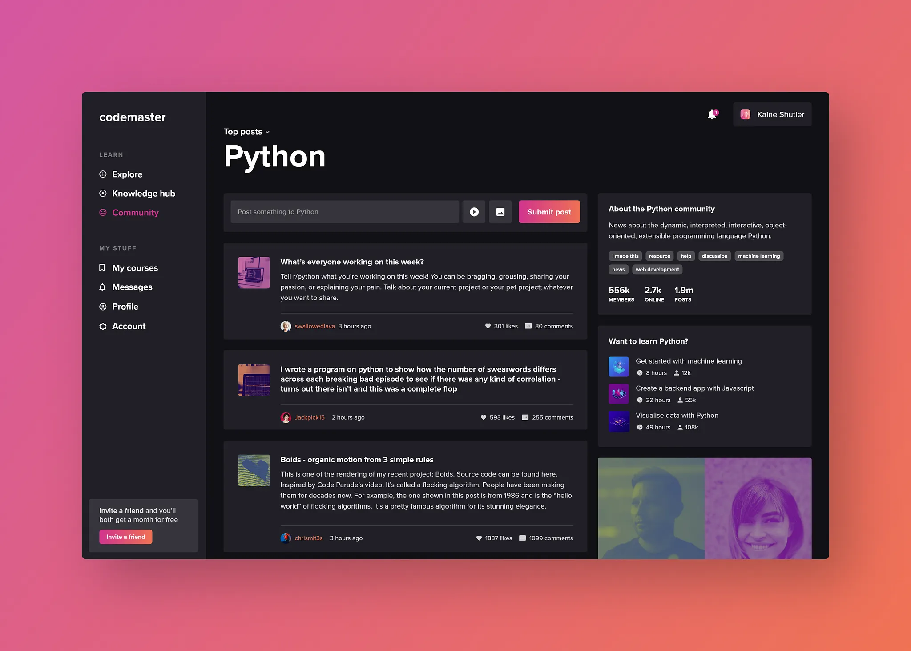
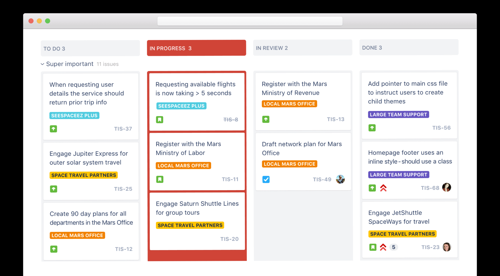
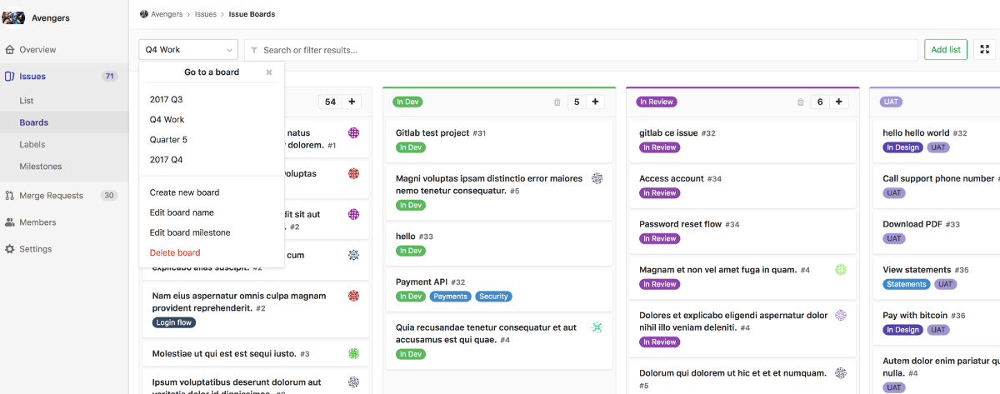
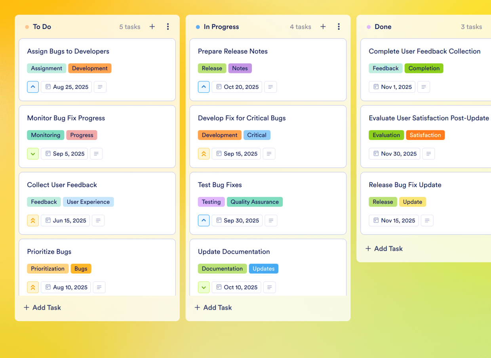

# Vibecoding Project Tracker — Design

**Status:** Design doc finalized · High-contrast, utilitarian dark UI in the tradition of MDN Web Docs and GitLab (Pajamas).

---

## 1. Mood / vibe

**One sentence:** A ruled, square-edged developer workspace, built like MDN and GitLab. Information sits in tables and divided lists rather than floating cards, contrast is high enough to read at a glance, and every control is a real, labelled, keyboard-reachable element.

### Design principles
1. **Lines, not boxes.** Group content with 1px rules, header rows and dividers. Don't wrap every item in its own bordered, rounded card.
2. **Square structure, rounded controls.** The page's structure has 0px corners: panels, board columns, bars, sidebars, alerts. **Controls and indicators may be rounded**: buttons (`rounded-md`), plus tags, date chips, status dots and progress bars (`rounded-full`). The angled accent is the **skewed brand mark**.
3. **Contrast is a feature.** All text meets WCAG 2.2 AA (4.5:1); body text and labels aim for AAA (7:1). Control outlines meet 3:1.
4. **Semantics first.** Use the right HTML element before adding ARIA. Styling never replaces structure.
5. **Colour is never the only signal.** Every colour-coded value also has a text label.

### Visual References
The images saved in the workspace define the visual language:

- **Reference 1 ( — Dark UI Structure & Contrast):** Deep charcoal surface hierarchy and vivid accent indicators.
- **Reference 2 ( — Kanban Layout & Urgency Tinting):** High-visibility column states, prominent status indicators, distinct category tags.
- **Reference 3 ( — Utilitarian Information Density):** GitLab-style issue tracking. Ruled rows, header bars with counters, dense metadata, filter strips.
- **External:** MDN Web Docs (square panels, underlined links, strong heading hierarchy, top-rule accents) and GitLab Pajamas (ruled tables, filter bars, compact rounded badges).

### Anti-references (What we explicitly avoid)
- **Anti-Reference ():** Soft, pastel, low-density themes with washed-out contrast.
- Rounded cards or panels as layout containers (`rounded-xl` columns, boxed task cards), glows, drop-shadow stacks, glassmorphism and `backdrop-blur`.
- Pulsing or animated urgency indicators.

---

## 2. Color palette

All values are defined as Tailwind tokens in `tailwind.config.js`. Ratios are measured against `surface-page` unless noted.

### 2.1 Brand & Surfaces

| Token | Hex | Contrast | Where it shows up |
|---|---|---|---|
| `brand-primary` | `#2563eb` | white text on it: 5.2:1 | Solid primary buttons, selected segmented options, avatars |
| `brand-hover` | `#1d4ed8` | white text on it: 6.7:1 | Primary button hover |
| `brand-accent` | `#7cb4ff` | 8.3:1 | Links, focus ring, active-tab underline, top-rule on panels |
| `surface-page` | `#17181b` | — | Root background; task rows |
| `surface-column` | `#1f2125` | — | Top bar, column header rows, filter strip, sidebars |
| `surface-card` | `#25272b` | — | Form controls, inset panels |
| `surface-elevated` | `#2e3035` | — | Row hover |
| `surface-code` | `#111214` | — | Monospace buffers (context, prompt history, URLs) |
| `border-subtle` | `#3a3d44` | decorative | Grid lines, row dividers |
| `border-strong` | `#6b7079` | 3.6:1 | Control outlines, header-row bottom rules |
| `text-primary` | `#ececef` | 15.1:1 | Headings, titles, body |
| `text-muted` | `#b0b4bc` | 8.5:1 (6.4:1 on `surface-elevated`) | Labels, metadata, counters |
| `text-subtle` | `#8f949c` | 5.8:1 (4.9:1 on `surface-card`) | Placeholders only |

Status tokens: `status-success #4ade80`, `status-warning #fbbf24`, `status-danger #f87171`.

---

### 2.2 Task Type Color Scale (Functional Category)

*Applied to the rounded **type tags**.*
*Mental model: the **warm spectrum (red/orange)** is for issues to fix. The **cool spectrum (blue/purple)** is for capabilities being built.*

All four use 400-weight shades, which measure 6.4–7.8:1 on `surface-page`.

| Task Type | Token | Hex | Tag classes | Meaning |
|---|---|---|---|---|
| **Urgent Fix** | `type-urgent` | `#f87171` | `tag text-type-urgent border-type-urgent/70 bg-type-urgent/10` | Blocker / emergency patch |
| **Bug** | `type-bug` | `#fb923c` | `tag text-type-bug border-type-bug/70 bg-type-bug/10` | Standard defect or regression |
| **Feature** | `type-feature` | `#60a5fa` | `tag text-type-feature border-type-feature/70 bg-type-feature/10` | Core roadmap deliverable |
| **Additional** | `type-additional` | `#c084fc` | `tag text-type-additional border-type-additional/70 bg-type-additional/10` | Enhancement / stretch goal |

The tag always prints the type name. The colour swatch inside it is `aria-hidden`.

---

### 2.3 Task Significance & Urgency Color Scale (Timeline)

*Applied to the **leading-edge rule** on each task row and to the **due-date tag**.*
*Mental model: a **heat scale** that runs from a red-hot deadline today down to a cold backlog.*

| Significance | Token | Hex | Rule class | Window |
|---|---|---|---|---|
| **Need Today** | `significance-today` | `#fb7185` | `bg-significance-today` | Due today or overdue |
| **Within 5 Days** | `significance-soon` | `#fbbf24` | `bg-significance-soon` | This work week |
| **Within 2 Weeks** | `significance-sprint` | `#38bdf8` | `bg-significance-sprint` | Current sprint |
| **Later** | `significance-later` | `#94a3b8` | `bg-slate-500` | Backlog / no date |
| **Completed** | — | — | `bg-slate-600` | Done tasks (overrides urgency) |

No glows and no pulsing. Urgency comes from colour plus the text label ("Need Today", "Overdue (3d)").

---

### 2.4 Dual-Scale Application Rules

To keep the two scales from competing on the same row:
1. **Type** always appears as the **rounded tag** at the top-left of the row.
2. **Significance** always appears as the **4px rule on the row's left edge** and the **due-date tag** at the top-right, rendered as a `<time>` element.

```
┌──────────────────────────────────────────────┐ ┌──────────
│ ● TO DO 3                                  + │ │ ● IN PROG   <- square column, header row;
├──────────────────────────────────────────────┤ ├──────────     small gutter between columns
▌ (● URGENT FIX)                 (● Need Today)│ ▌ ...         <- left rule = significance,
▌ Database timeout during bulk task fetch      │ │                rounded tags = type / due date
▌ Pooling exhausts after 30 concurrent reqs…   │ │
▌ [TE] Teammate A       Claude (2k chars)      │ │
├──────────────────────────────────────────────┤ │             <- 1px divider, no card box
▌ (● FEATURE)                    (● In 4 days) │ │
```

---

## 3. Typography

| Role | Font | Why |
|---|---|---|
| Heading / Body | `Inter`, `system-ui`, sans-serif | Neutral, highly legible on dark surfaces |
| Monospace | `JetBrains Mono`, `ui-monospace`, monospace | Counters, dates, IDs, prompt/context buffers |

Both load from Google Fonts with system fallbacks.

### Type scale
- **Page title (h1):** 20px / Bold (`text-xl font-bold tracking-tight`)
- **Column / section header (h2):** 12px / Bold uppercase (`text-xs font-bold uppercase tracking-wider`)
- **Task title (h3):** 14px / Semibold (`text-sm font-semibold leading-snug`)
- **Body / description:** 12–14px / Regular, `text-text-muted`, `leading-relaxed`
- **Field labels:** 12px / Semibold uppercase (`.field-label`)
- **Tags & dates:** 11px / Semibold (`.tag`)

Heading levels must not skip: each page has one `h1`, sections use `h2`, rows and cells use `h3`.

---

## 4. Component Principles

Shared classes live in `src/index.css` under `@layer components`.

| Component | Spec |
|---|---|
| **Board** | `grid gap-3` of square columns (1 / 2 / 4 per row). A small gutter separates the columns; inside each one, tasks stay as ruled rows. |
| **Column** | `<section aria-labelledby>`, square `border border-border-subtle`. Header row: `h-10 bg-surface-column border-b border-border-strong` with an `h2`, a count, and an icon button that has an `aria-label`. |
| **Task row** | `<li>` › `<article>`, **no border box and no radius**. `pl-4 pr-3 py-3`, `divide-y` between rows, `hover:bg-surface-elevated`. The title is a `<button>` stretched over the row with `after:absolute after:inset-0`. Rows hold no other controls: the assignee is read-only text, and reassigning happens in the task editor. If an inline control is ever added, it must sit above the stretched button on `z-10`. |
| **Tags / indicators** | `.tag`: `rounded-full`, 1px border, 11px uppercase, with a round status dot. Used for type, due date and deliverable status. Progress bars and dots are also `rounded-full`. |
| **Buttons** | `.btn-primary` (solid brand fill), `.btn-secondary` (outlined), `.btn-ghost`, `.btn-danger`. All `rounded-md`, no shadows. |
| **Inputs** | `.field`: square, `bg-surface-card border-border-strong`, accent border + 2px outline on focus. Every input has a `<label htmlFor>`. |
| **Panels** | Square, `border border-border-subtle`, with a **2px top rule** in `brand-accent` (MDN-style) or a section header row. Never `rounded-*`. |
| **Tabs / view switchers** | Underline tabs: `border-b-2`, active = `border-brand-accent`. Use `aria-pressed` for toggle groups. |
| **Choice buttons** (stage, category type) | `grid grid-cols-2 gap-2` of `rounded-md border` buttons; selected = `bg-brand-primary text-white` plus `aria-pressed`. |
| **Filter bar** | Full-width strip with `border-y`, holding toggles, sort, live count and legend. GitLab-style. |
| **Alerts / toasts** | Square with a **4px left rule** in the semantic colour. `role="alert"` for errors, `role="status"` / `aria-live="polite"` for confirmations. |
| **Empty states** | Plain muted text plus a text link, inside the ruled cell. Never a dashed rounded box. |
| **Avatars** | Square initials blocks (`bg-brand-primary text-white`), `aria-hidden` when a name is shown beside them. |
| **Brand mark** | Skewed parallelogram (`-skew-x-12`) with an accent→primary gradient. |

**Radius budget:**
- **Structure (`0`):** page sections, board columns, task rows, panels, sidebars, top bar, filter strip, alerts/toasts, form fields.
- **Controls (`rounded-md`):** every button, including the choice buttons.
- **Indicators (`rounded-full`):** tags, date chips, status dots, progress bars.
- **Angled accents:** the skewed brand mark, and the chamfered profile avatar (`.chamfer`).

---

## 5. Accessibility

Target: **WCAG 2.2 AA** across the app.

- **Landmarks:** every page has `<header>`, `<main>` and, where relevant, `<nav aria-label>` / `<aside>`. The board and editor include a **skip link** (`.skip-link`).
- **Headings:** a logical `h1 → h2 → h3` outline (page → column/section → task/cell).
- **Lists & tables:** task columns are `<ul>`, team members are a `<table>` with `<th scope>`, metadata uses `<dl>`.
- **Forms:** each control has a visible `<label htmlFor>` (or `sr-only` where the placeholder carries the visual label). Related controls are grouped in `<fieldset>`/`<legend>`. Hints are attached with `aria-describedby`. Inputs carry `autocomplete` tokens.
- **Focus:** a global `:focus-visible` outline of 2px in `brand-accent` with a 2px offset. Chamfered elements draw the ring inset so `clip-path` can't hide it.
- **State:** toggles use `aria-pressed`, disclosures use `aria-expanded` + `aria-controls`, and the current team uses `aria-current`.
- **Announcements:** copy and hand-off toasts, save results and task counts live in `aria-live`/`role="status"` regions.
- **Icons:** decorative SVGs and colour swatches are `aria-hidden="true"`. Icon-only buttons have `aria-label`. External links say "(opens in new tab)" to screen readers.
- **Motion:** 150ms fades only. `prefers-reduced-motion` disables transitions and animations.
- **Colour:** never the sole carrier of meaning (see §2.2–2.3).

---

## 6. Voice / microcopy

| Where | Text |
|---|---|
| "+" button label | `+ Add Task` |
| Empty column placeholder | `No tasks in this stage yet` |
| Toast after "Copy as Prompt Context" (task + description + context) | `Prompt context copied to clipboard` |
| Toast after "Copy Context" (context only) | `Context copied to clipboard` |
| Confirm-delete message | `Deleting this task will PERMANENTLY delete all context and history` |
| Handoff toast (M7 `task-owner`) | `Handed off to {name}. Make sure they have necessary context.` |
| Account action | `Sign out` |

No emoji in UI chrome. Use text tags instead (e.g. `Read-Only`).

---

## 7. Logo / Wordmark

- **Product name:** **VibeTracker**, used on every screen (login, register, teams, board).
- **Wordmark:** `src/components/Wordmark.jsx`. A skewed accent-gradient bar followed by `VibeTracker` in `font-extrabold tracking-tight text-text-primary`.

---

## 8. Out of Scope (This Hackathon)

- A light mode toggle. We ship one polished high-contrast dark theme.
- Multiple themes.
- Complex physics-based animation (motion is limited to 150ms fades).
- A custom icon set (we use standard inline SVG / Lucide-style strokes).
